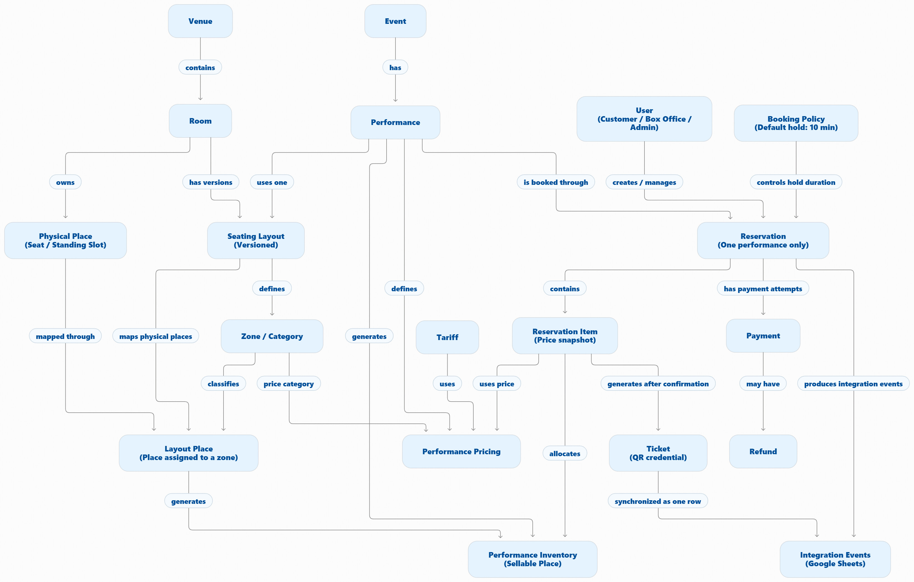
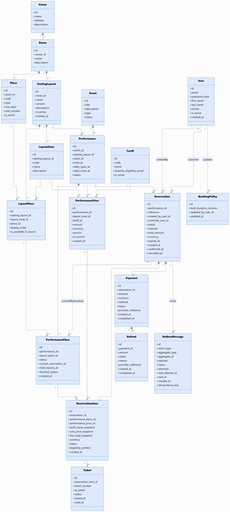
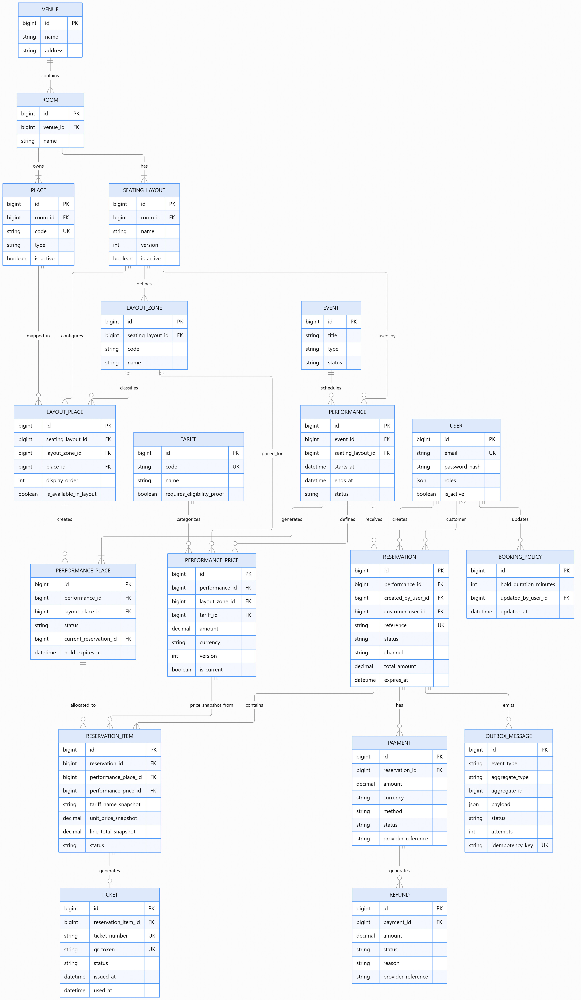
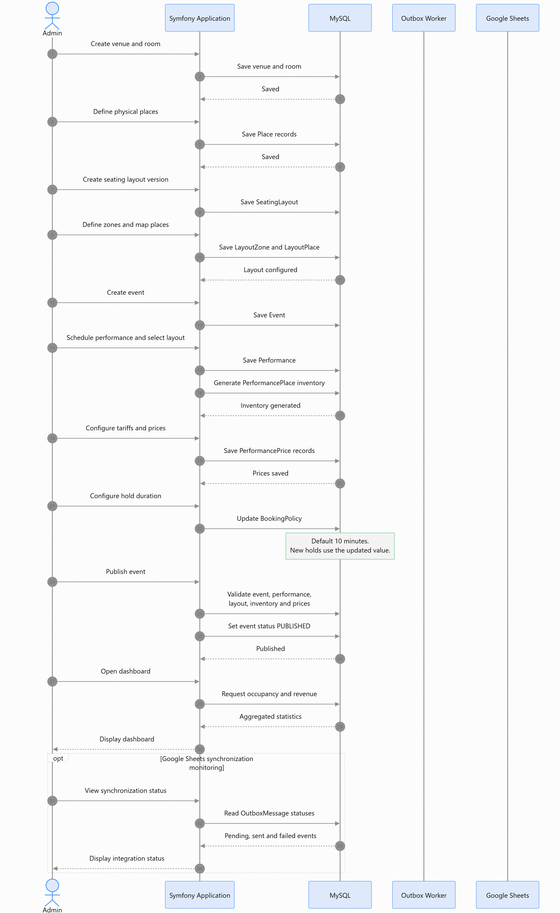
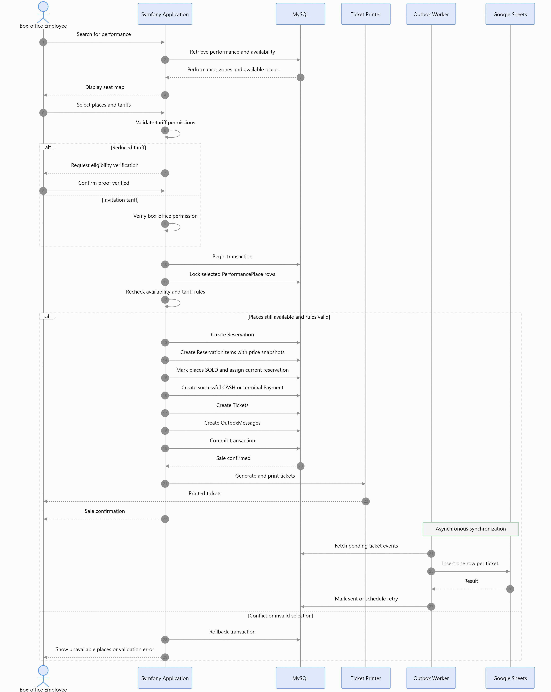
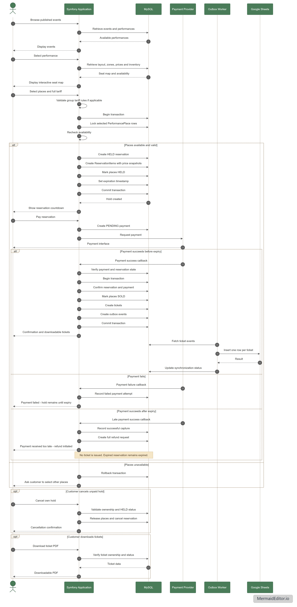
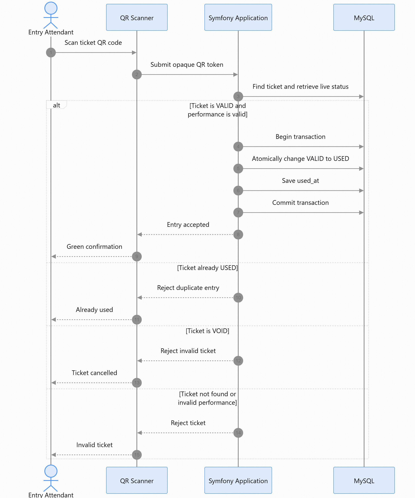
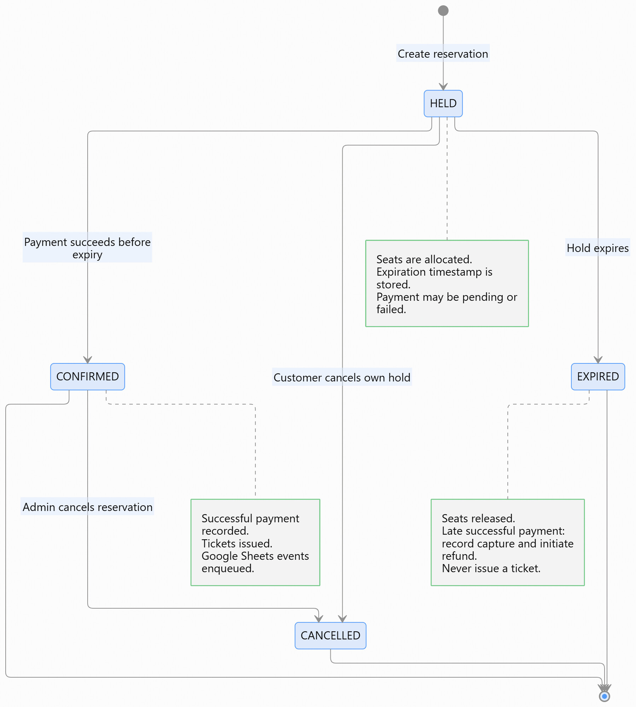
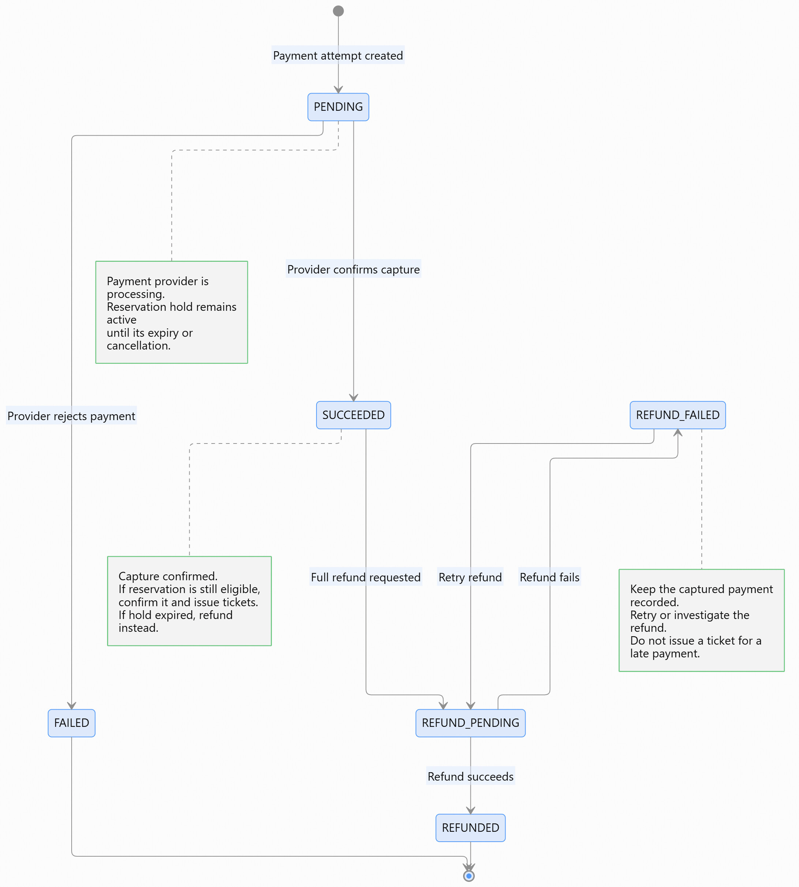
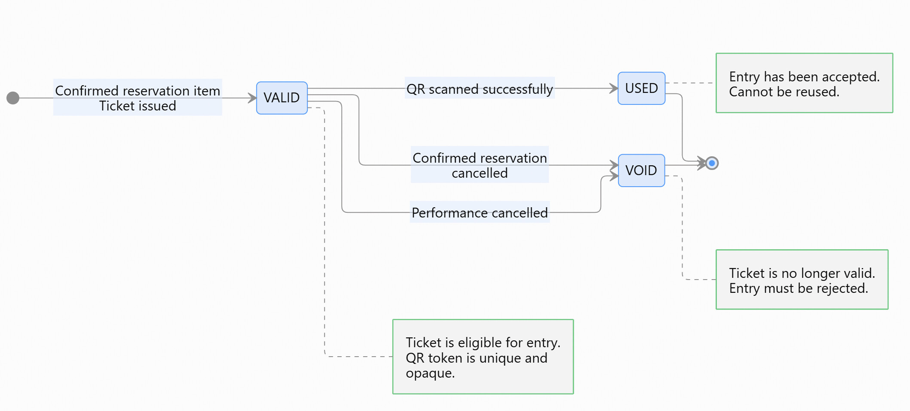

# Data Model - Performance Venue Ticketing

| | |
|---|---|
| **Project** | PFE Challenge EMC - Subject 1 of 4 |
| **Application** | Online and box-office ticketing for a 400-seat venue |
| **Stack** | Symfony 7.4 · PHP 8.2+ · MySQL 8 · Doctrine ORM · Migrations |
| **Model version** | **2.0 - validated on 2026-11-09** |
| **Status** | Design complete — implementation in progress (see [`docs/DEVELOPMENT.md`](DEVELOPMENT.md) §17) |
| **Related documents** | [`docs/DECISIONS.md`](DECISIONS.md) · [`docs/WORKFLOWS.md`](WORKFLOWS.md) · [`docs/DEVELOPMENT.md`](DEVELOPMENT.md) · [`README.md`](../README.md) |

---

## 0. How to read this document

This document describes **the domain data model** and explains **why** it is designed this way. It is based on the diagrams produced during the design phase (images in this folder).

It targets two audiences:

- **the evaluators**: it justifies the design choices and demonstrates the model's consistency;
- **the development team**: it serves as a reference before writing the Doctrine entities and migrations.

The guiding rule is: **the model protects the business rules, not just the interface.** Everything drawn here must translate into database constraints, business services, and automated tests.

---

## 1. Founding principles

Four principles structure the entire design. Every entity and every relationship can be traced back to one of them.

### 1.1 Separate the physical from the sellable

A physical seat (A12) exists independently of any show. What is sold is not "seat A12", but **seat A12 for a given performance**. Hence three distinct levels:

| Level | Entity | Question it answers |
|---|---|---|
| Physical | `Place` | Which seats exist in the room? |
| Configuration | `SeatingLayout` → `LayoutZone` → `LayoutPlace` | How are those seats arranged and grouped for a given configuration? |
| Inventory | `PerformancePlace` | Which seats are available / held / sold **for this performance**? |

Direct consequence: seat A12 can be **sold** for Friday's concert, **temporarily held** for Saturday's play, and **available** for Sunday's conference, without any contradiction.

### 1.2 Guarantee the rules at the database level

Availability is not checked only in the browser with JavaScript. Two customers clicking the same seat at the same moment must not both get it. Protection relies on:

- **unique constraints** (one inventory row per seat per performance);
- **transactions**;
- **row locking** (`SELECT … FOR UPDATE`) at allocation time.

### 1.3 Preserve history

An expired or cancelled reservation never deletes records. The inventory is released (`AVAILABLE`), but historical `ReservationItem` rows remain in the database. This is what makes it possible to track sales, revenue, and occupancy without losing the trace of past attempts.

### 1.4 One sales flow, two channels

Online and box-office sales use **the same seat allocation mechanism**. There is no separate availability logic per channel. The channel (`ONLINE` / `BOX_OFFICE`) is a reservation attribute, not a parallel model.

---

## 2. Domain overview

The domain is split into **seven business areas**. Each area groups concepts that evolve together.

| Business area | Concepts |
|---|---|
| **Venue & seating** | `Venue`, `Room`, `Place`, `SeatingLayout`, `LayoutZone`, `LayoutPlace` |
| **Programming** | `Event`, `Performance` |
| **Pricing** | `Tariff`, `PerformancePrice` |
| **Inventory & reservations** | `PerformancePlace`, `Reservation`, `ReservationItem`, `BookingPolicy` |
| **Payment & refunds** | `Payment`, `Refund` |
| **Ticketing** | `Ticket` |
| **Identity & access** | `User` (roles: `CUSTOMER`, `BOX_OFFICE`, `ADMIN`) |
| **Integration** | `OutboxMessage` (Google Sheets synchronization) |

The Google Sheets integration is treated as a **cross-cutting concern** (outbox), not as a core domain concept.

---

## 3. Conceptual domain model

This diagram shows the **business concepts** and their dependencies, without implementation details.

### 3.1 Reading the diagram

- **Left**: the physical structure - `Venue` → `Room` → `Place`, and the versioned configuration `SeatingLayout` → `LayoutPlace`.
- **Center**: programming - `Event` → `Performance`, which uses a configuration and generates the `PerformancePlace` inventory.
- **Right**: the purchase journey - `Reservation` → `ReservationItem` → `Ticket`, with `Payment` and `Refund`.
- **Top right**: `User` and `BookingPolicy`, which control the hold duration.
- **Bottom right**: `OutboxMessage`, which carries integration events to Google Sheets.

### 3.2 Key distinction

| Concept | Nature | Example |
|---|---|---|
| `Place` | **Physical entity** | Seat A12, which exists regardless of performances. |
| `LayoutPlace` | **Configuration association** | "Seat A12 belongs to the VIP zone in the Standard configuration v1." |
| `PerformancePlace` | **Sellable inventory** | "Seat A12 is available for Friday's concert." |

This is the model's reason for being: **reusing the venue from one event to another without duplicating physical seats**.

---

## 4. Class diagram

### 4.1 Entities and responsibilities

| Entity | Responsibility |
|---|---|
| `Venue` | Performance venue (name, address). |
| `Room` | Room belonging to a venue. |
| `Place` | Physical seat: numbered seat or standing slot (`code`, `type`, `row_label`, `seat_number`). |
| `SeatingLayout` | **Versioned** room configuration (`name`, `version`, `is_active`). |
| `LayoutZone` | Zone / category within a configuration (`code`, `name`). |
| `LayoutPlace` | Associates a physical seat with a zone **within a given configuration**. |
| `Event` | Cultural event (concert, theatre, conference). |
| `Performance` | Dated performance of an event; carries the sales hours. |
| `Tariff` | Pricing category (full, reduced, group, invitation). |
| `PerformancePrice` | Price of a tariff for a performance and a zone (**versioned**). |
| `PerformancePlace` | Sellable inventory of a seat for a performance (state + current allocation). |
| `User` | Account (customer, box-office employee, administrator) with roles. |
| `BookingPolicy` | Configurable booking rules (hold duration). |
| `Reservation` | Reservation for **a single performance** (hold then confirmation). |
| `ReservationItem` | One reserved seat, with a **snapshot** of the tariff and price. |
| `Payment` | Payment attempt (can fail, can be retried). |
| `Refund` | Refund linked to a payment. |
| `Ticket` | Admission ticket (number + QR token) issued after confirmation. |
| `OutboxMessage` | Asynchronous integration event (Google Sheets). |

### 4.2 Explained relationships

Multiplicities are read from the opposite class.

| Relationship | Multiplicity | Justification |
|---|---|---|
| `Venue → Room` | 1 → 1..* | A venue contains one or more rooms; a room belongs to one venue. |
| `Room → Place` | 1 → 1..* | Physical seats belong to the room, not to a configuration. |
| `Room → SeatingLayout` | 1 → 1..* | The same room can have several configurations (concert, conference…). |
| `SeatingLayout → LayoutZone` | 1 → 1..* | A configuration defines its zones. |
| `SeatingLayout → LayoutPlace` | 1 → 1..* | A configuration maps seats. |
| `LayoutZone → LayoutPlace` | 1 → 0..* | A seat is placed in a zone. |
| `Place → LayoutPlace` | 1 → 0..* | The same physical seat can appear in several configurations. |
| `Event → Performance` | 1 → 0..* | An event can have several performances; a performance belongs to one event. |
| `SeatingLayout → Performance` | 1 → 0..* | A performance uses **exactly one** configuration. |
| `Performance → PerformancePlace` | 1 → 1..* | Each performance configuration generates its inventory. |
| `LayoutPlace → PerformancePlace` | 1 → 0..* | A layout slot becomes a sellable seat for a performance. |
| `Performance → PerformancePrice` | 1 → 0..* | A performance defines its prices. |
| `LayoutZone → PerformancePrice` | 1 → 0..* | Prices are set per zone. |
| `Tariff → PerformancePrice` | 1 → 0..* | A tariff is broken down into several contextual prices. |
| `PerformancePlace → ReservationItem` | 1 → 0..* | History: the same seat can go through several reservations over time. |
| `PerformancePrice → ReservationItem` | 1 → 0..* | History of prices used. |
| `Performance → Reservation` | 1 → 0..* | A reservation covers **a single** performance. |
| `User → Reservation` (`createdBy`) | 1 → 0..* | Who initiated the reservation (online customer or box-office employee). |
| `User → Reservation` (`customer`) | 0..1 → 0..* | For whom the reservation is made (anonymous possible at the box office). |
| `Reservation → ReservationItem` | 1 → 1..* | A reservation contains one or more seats. |
| `Reservation → PerformancePlace` (`currentReservation`) | 0..1 → 0..* | **Current** allocation: the reservation holding or owning the seat. |
| `Reservation → Payment` | 1 → 0..* | A reservation can have several payment attempts. |
| `Payment → Refund` | 1 → 0..* | A payment can be refunded (one or more times). |
| `ReservationItem → Ticket` | 1 → 0..1 | A confirmed item generates **at most one** ticket. |
| `Reservation → OutboxMessage` | 1 → 0..* | The reservation emits integration events. |
| `User → BookingPolicy` (`updates`) | 1 → 0..* | Traceability of the last admin who changed the policy. |

### 4.3 Why `currentReservation` and history coexist

This is a major design point.

- **`PerformancePlace.currentReservation`** answers: *"Who holds this seat right now?"*
- **`ReservationItem`** answers: *"Which reservations, including expired or cancelled ones, involved this seat?"*

Example: A12 is reserved by customer A → payment failure → expiry → A12 becomes available again → reserved by customer B → successful payment. There are then **two** `ReservationItem` rows for A12, but only one `currentReservation` (customer B's). Deleting the history to release the seat would be a design mistake.

### 4.4 Enumerations

| Enumeration | Values | Role |
|---|---|---|
| `PlaceType` | `SEAT`, `STANDING_SLOT` | Numbered seat or standing slot. |
| `EventType` | `CONCERT`, `THEATRE`, `CONFERENCE`, `OTHER` | Nature of the event. |
| `EventStatus` | `DRAFT`, `PUBLISHED`, `ARCHIVED` | Event lifecycle. |
| `PerformanceStatus` | `SCHEDULED`, `CANCELLED`, `COMPLETED` | Performance lifecycle. |
| `InventoryStatus` | `AVAILABLE`, `HELD`, `SOLD`, `BLOCKED` | Inventory state. |
| `ReservationStatus` | `HELD`, `CONFIRMED`, `EXPIRED`, `CANCELLED` | Reservation lifecycle. |
| `ReservationItemStatus` | `HELD`, `CONFIRMED`, `EXPIRED`, `CANCELLED` | Item lifecycle. |
| `SalesChannel` | `ONLINE`, `BOX_OFFICE` | Sales channel. |
| `PaymentMethod` | `ONLINE`, `CASH`, `CARD_TERMINAL` | Payment method. |
| `PaymentStatus` | `PENDING`, `SUCCEEDED`, `FAILED` | Attempt state. |
| `RefundStatus` | `PENDING`, `SUCCEEDED`, `FAILED` | Refund state. |
| `TicketStatus` | `VALID`, `USED`, `VOID` | Ticket state. |
| `OutboxStatus` | `PENDING`, `PROCESSING`, `SENT`, `FAILED` | Integration event state. |

---

## 5. Entity-relationship diagram (ERD)

### 5.1 Relational structure

The diagram describes the tables, primary keys (`PK`), foreign keys (`FK`), and unique constraints (`UK`). Amounts are stored as `decimal`, dates as `datetime`, and roles as `json` (array of roles).

### 5.2 Uniqueness and integrity constraints

| Table | Constraint | Purpose |
|---|---|---|
| `place` | `UNIQUE (room_id, code)` | A seat has a unique code within its room. |
| `seating_layout` | `UNIQUE (room_id, version)` | A version is unique within its room. |
| `layout_zone` | `UNIQUE (seating_layout_id, code)` | A zone code is unique within its configuration. |
| `layout_place` | `UNIQUE (seating_layout_id, place_id)` | A seat appears only once per configuration. |
| `performance_price` | `UNIQUE (performance_id, layout_zone_id, tariff_id, version)` | A single current price per combination. |
| `performance_place` | `UNIQUE (performance_id, layout_place_id)` | **One inventory row per seat per performance** (anti double-selling). |
| `reservation` | `UNIQUE (reference)` | Unique reservation reference. |
| `reservation_item` | `UNIQUE (reservation_id, performance_place_id)` | The same seat appears only once in a reservation. |
| `ticket` | `UNIQUE (reservation_item_id)`, `UNIQUE (ticket_number)`, `UNIQUE (qr_token)` | One ticket per item, unique references. |
| `user` | `UNIQUE (email)` | One account per email. |
| `outbox_message` | `UNIQUE (idempotency_key)` | Idempotent integration event. |

### 5.3 Cross-cutting rules (beyond foreign keys)

Some rules cannot be expressed with a simple foreign key. They will be validated in business services, within transactions, and covered by tests.

| Rule | Verification |
|---|---|
| `LayoutPlace` references a `Place` and a `LayoutZone` belonging to the **same room/configuration** as the `SeatingLayout`. | Service + tests |
| `PerformancePlace` references a `LayoutPlace` belonging to the performance's configuration. | Service + tests |
| `ReservationItem` references a seat and a price belonging to the **same performance** as the reservation. | Service + tests |
| The `PerformancePrice` zone must match the reserved seat's zone. | Service + tests |
| A ticket is issued only for a `CONFIRMED` item. | Service + tests |

### 5.4 `PerformancePlace` state invariant

This is the table that prevents double-selling.

| `status` | `current_reservation_id` | `hold_expires_at` |
|---|---|---|
| `AVAILABLE` | `NULL` | `NULL` |
| `HELD` | not null | not null |
| `SOLD` | not null | `NULL` |
| `BLOCKED` | `NULL` | `NULL` |

Any transition must respect this consistency (for example, no `HELD` without an expiration date).

---

## 6. Sequence diagrams

Four actors interact with the system. The diagrams show transactions and critical control points.

### 6.1 Administrator

The administrator configures the venue (venue, room, seats), creates versioned configurations, schedules events and performances, sets prices and the booking policy, then publishes and monitors activity.

Key points: publication is **validated** (performance, configuration, inventory, and prices present); a configuration already used is **not editable**.

### 6.2 Box office

The box-office employee selects a performance and seats, applies an authorized tariff, checks supporting documents for a reduced tariff, collects payment (cash or terminal), then issues tickets.

Key points: **same allocation mechanism as the web**; eligibility check; transaction covering reservation, payment, tickets, and integration events.

### 6.3 Customer

The customer browses events, chooses a performance and seats, then pays online. The diagram distinguishes three outcomes: payment success before expiry, payment failure, and **late payment after expiry**.

Key points: the hold is timestamped server-side; a late payment **never** issues a ticket and triggers a refund.

### 6.4 Entry attendant

The attendant scans the ticket's QR code. The `VALID → USED` transition is **atomic** (row lock): two simultaneous scans cannot both be accepted. A ticket that is `USED` or `VOID` is rejected.

---

## 7. Lifecycles

Three entities have their own lifecycle. Transitions are constrained, not free.

### 7.1 Reservation

| State | Meaning | Possible transitions |
|---|---|---|
| `HELD` | Seats allocated, payment pending. | `CONFIRMED`, `EXPIRED`, `CANCELLED` |
| `CONFIRMED` | Payment successful, tickets issued. | `CANCELLED` |
| `EXPIRED` | Hold expired, seats released. | - (terminal) |
| `CANCELLED` | Reservation cancelled. | - (terminal) |

### 7.2 Payment

| State | Meaning |
|---|---|
| `PENDING` | Attempt in progress at the provider. |
| `SUCCEEDED` | Payment successfully captured. |
| `FAILED` | Attempt declined. |

The refund has its **own** lifecycle (`PENDING` → `SUCCEEDED` / `FAILED`): a payment can therefore be `SUCCEEDED` while its refund is still `PENDING`. A reservation can be `CANCELLED` without the refund being complete.

### 7.3 Ticket

| State | Meaning | Transitions |
|---|---|---|
| `VALID` | Issued, not scanned. | `USED`, `VOID` |
| `USED` | Entry accepted. | - (terminal) |
| `VOID` | Cancelled / invalidated. | - (terminal) |

A ticket is **never reactivated**. In case of cancellation and then a new reservation, a new ticket is issued.

---

## 8. Explained design choices

Each choice is justified by a business constraint or a technical consequence.

### C1 - Why `Place` / `LayoutPlace` / `PerformancePlace`?

Because a change to the room configuration (moving a seat to another zone, adding a standing pit) must not alter past sales. The physical seat keeps its identity; the configuration places it; the performance sells it.

### C2 - Why `Reservation` and not `Order`?

The challenge describes a **journey**: selection → temporary hold → payment → confirmation. It is a **single aggregate** with a lifecycle, not two entities. Introducing `Order` would add unnecessary complexity for the MVP scope.

### C3 - Why price snapshots?

Because the price of a ticket **already sold must not change** if the tariff is modified afterwards. `ReservationItem` freezes `tariff_name_snapshot`, `unit_price_snapshot`, and `line_total_snapshot`. `PerformancePrice` rows are also versioned (`version`, `is_current`).

### C4 - Why transaction + locking?

Because a prior availability check does not prevent two simultaneous requests from completing. Only row locking within a transaction guarantees that a single transaction wins.

### C5 - Why a transactional outbox?

Because a sale must not depend on Google Sheets being available. The event is written to `outbox_message` in the **same transaction** as the sale, then processed by a worker with an idempotency key and retries on failure.

### C6 - Why one performance per reservation?

Because the hold, payment, cancellation, and refunds are then simple and consistent. Booking two shows in one go would create complex total, expiry, and partial-refund calculations. Two performances → two reservations.

### C7 - Why a configurable hold duration?

Because 10 minutes suits most cases, but an administrator may want to adjust it. The expiration timestamp is **stored when the hold is created**: changing the policy does not affect holds in progress.

### C8 - Why distinct roles?

Because the rights are not symmetric: a customer cannot apply an invitation tariff, a box-office employee cannot cancel a confirmed reservation, and an administrator does not necessarily sell at the box office. Roles are carried by `User` and enforced server-side.

---

## 9. Constraints and invariants

Summary of the invariants the implementation must respect.

| # | Constraint |
|---|---|
| INV-01 | A physical seat appears only once per performance inventory. |
| INV-02 | A seat cannot be held by two active reservations at the same time. |
| INV-03 | A reservation cannot be confirmed after its expiry. |
| INV-04 | A reservation belongs to exactly one performance. |
| INV-05 | The price of a confirmed reservation is immutable. |
| INV-06 | A ticket can be issued only for a confirmed item, and at most one ticket per item. |
| INV-07 | A refunded or cancelled ticket becomes `VOID` and is rejected at entry. |
| INV-08 | A performance cannot sell beyond its capacity. |
| INV-09 | Certain tariffs can only be applied by certain roles. |
| INV-10 | Online and box-office sales share the same availability rules. |
| INV-11 | Revenue and occupancy account for cancellations and refunds. |
| INV-12 | A Google Sheets outage neither blocks nor cancels a sale. |

---

## 10. MVP scope boundaries

To stay realistic within seven days, the following are **explicitly out of scope** for the first version. None of them requires redesigning the model.

- Partial refunds and partial reservation cancellation.
- Split payments or several successful payments per reservation.
- Online reduced-tariff requests (self-declaration).
- Several performances within one reservation.
- Editing a configuration already used by a performance.
- Promo codes, loyalty programs, dynamic pricing.
- Advanced reconciliation with the payment provider.
- Dedicated mobile scanning application.

---

## 11. See also

- [`docs/DECISIONS.md`](DECISIONS.md) - dated decision log and answers to the "Questions to settle".
- [`docs/WORKFLOWS.md`](WORKFLOWS.md) - the approved business workflows, transcribed from the sequence diagrams.
- [`docs/DEVELOPMENT.md`](DEVELOPMENT.md) - roadmap, coding conventions, technical foundation and known issues.
- [`README.md`](../README.md) - project overview, stack, installation and development progress.
- [`INSTALL.md`](../INSTALL.md) - step-by-step installation guide (delivered with the deployment phase).
