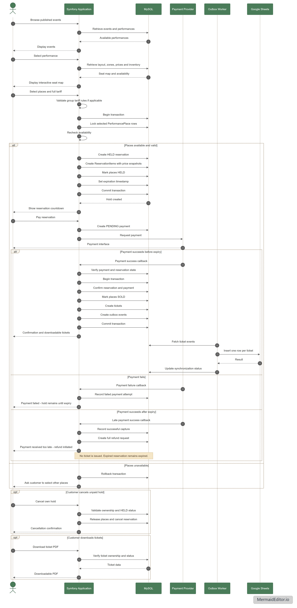
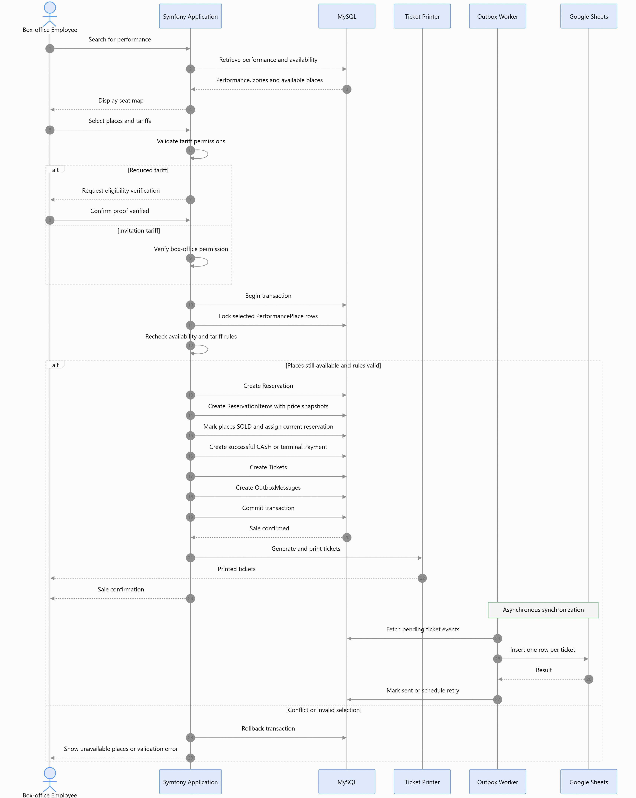
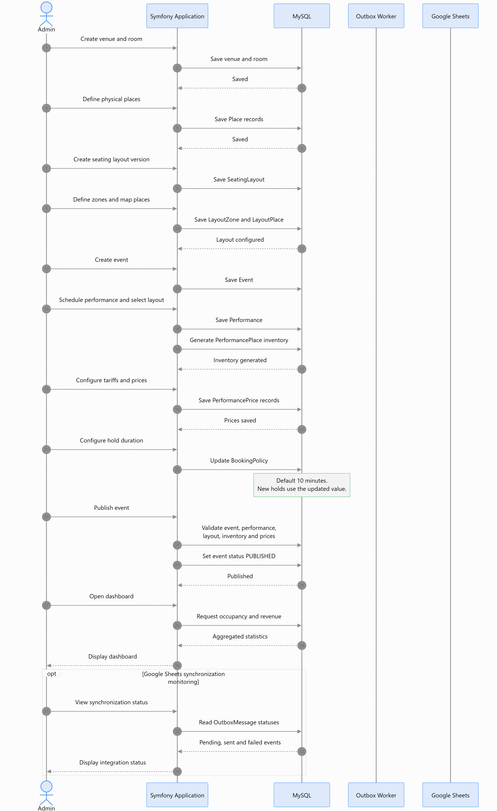
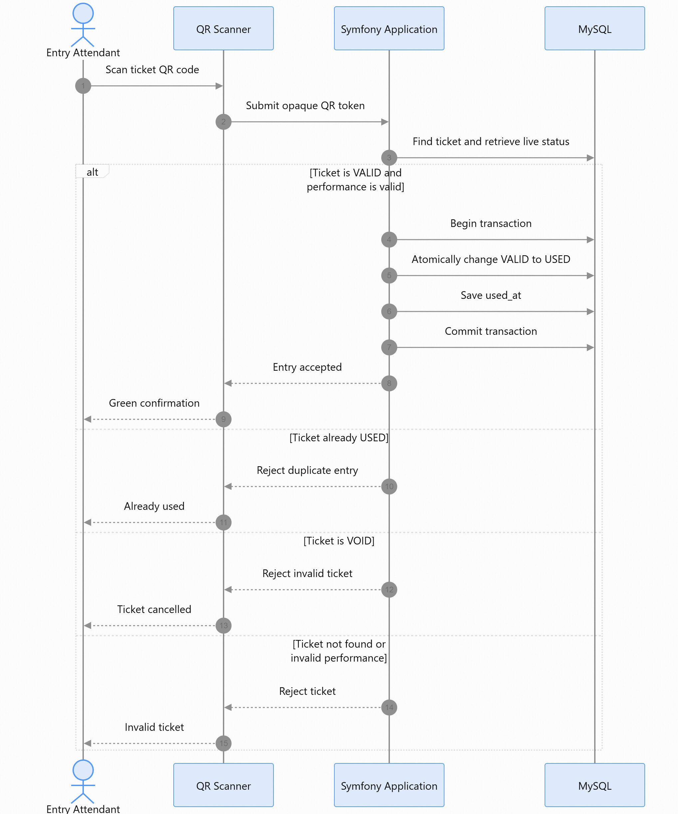
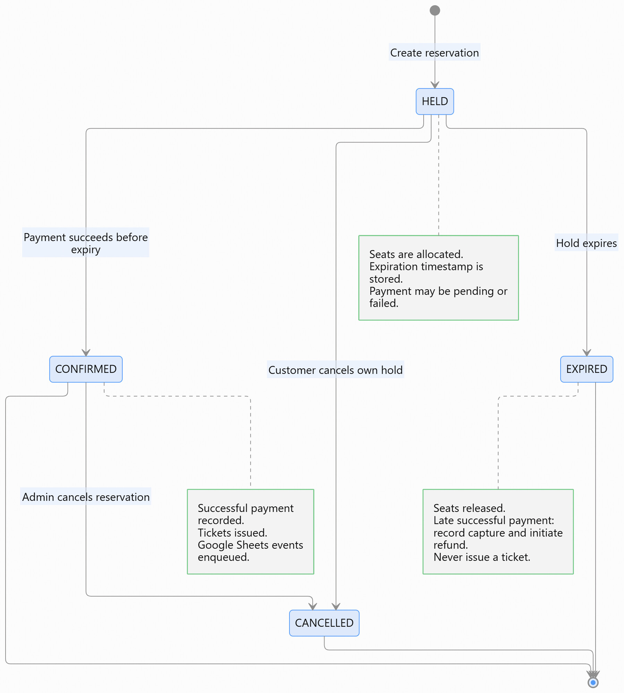
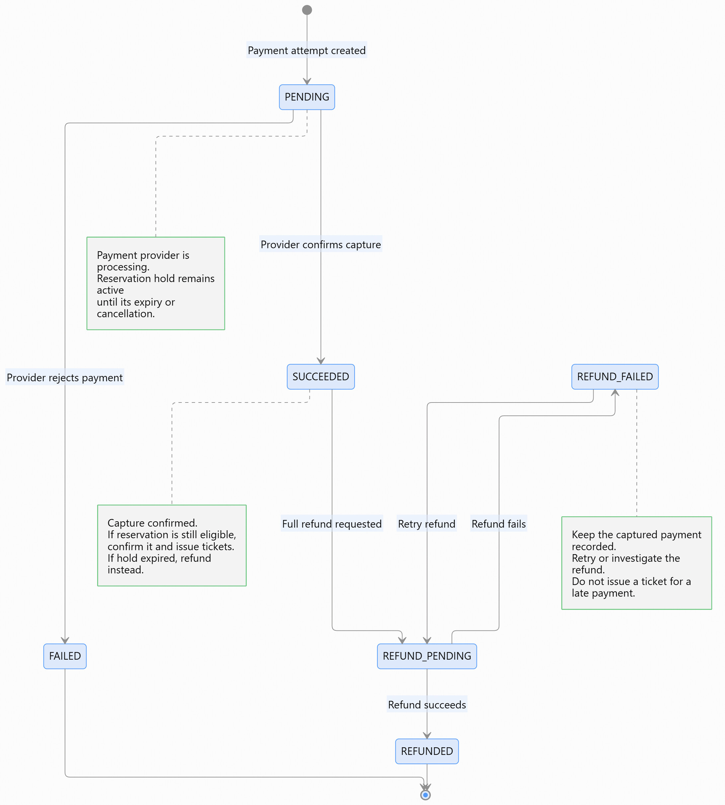
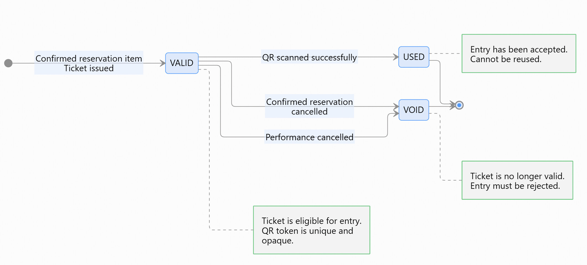

# Business Workflows

| | |
|---|---|
| **Project** | Performance Venue Ticketing — PFE Challenge EMC 2026 |
| **Status** | Approved — transcribed from the sequence diagrams in `docs/sequence-diagrams/` |
| **Last updated** | 2026-11-10 |
| **Related documents** | [`docs/MODELE.md`](MODELE.md) · [`docs/DECISIONS.md`](DECISIONS.md) · [`docs/DEVELOPMENT.md`](DEVELOPMENT.md) |

---

## 0. How to read this document

This document describes the **approved business workflows**. It is the transcription of the
diagrams committed in `docs/`:

- [`sequence-diagrams/customer-sequence-diagram.jpg`](sequence-diagrams/customer-sequence-diagram.jpg)
- [`sequence-diagrams/box-office-sequence-diagram.jpg`](sequence-diagrams/box-office-sequence-diagram.jpg)
- [`sequence-diagrams/admin-sequence-diagram.jpg`](sequence-diagrams/admin-sequence-diagram.jpg)
- [`sequence-diagrams/entry-attendant-sequence-diagram.jpg`](sequence-diagrams/entry-attendant-sequence-diagram.jpg)
- [`lifecycle/reservation-lifecycle.jpg`](lifecycle/reservation-lifecycle.jpg)
- [`lifecycle/payment-lifecycle.jpg`](lifecycle/payment-lifecycle.jpg)
- [`lifecycle/ticket-lifecycle.jpg`](lifecycle/ticket-lifecycle.jpg)

It does **not** introduce new rules. Where this document and the diagrams disagree, the
diagrams are authoritative and this document must be corrected.

Every workflow is annotated with the phase that implements it.

---

## 1. Universal invariants

These apply to every workflow. They are not repeated in each section.

| ID | Invariant | Enforced by |
|---|---|---|
| INV-01 | A physical seat appears only once per performance inventory. | `UNIQUE (performance_id, layout_place_id)` |
| INV-02 | A seat cannot be held by two active reservations at the same time. | `SELECT … FOR UPDATE` inside the transaction |
| INV-03 | A reservation cannot be confirmed after its expiry. | Entity state machine + `expires_at` |
| INV-04 | A reservation belongs to exactly one performance. | `reservation.performance_id NOT NULL` |
| INV-05 | The price of a confirmed reservation is immutable. | Snapshots on `reservation_item` |
| INV-06 | A ticket is issued only for a confirmed item, at most one per item. | `UNIQUE (reservation_item_id)` |
| INV-07 | A refunded or cancelled ticket becomes `VOID` and is rejected at entry. | Ticket lifecycle |
| INV-08 | A performance cannot sell beyond its capacity. | One `performance_place` per `layout_place` |
| INV-09 | Certain tariffs can only be applied by certain roles. | Server-side role checks |
| INV-10 | Online and box-office sales share the same availability rules. | One allocation engine |
| INV-11 | Revenue and occupancy account for cancellations and refunds. | Reporting queries |
| INV-12 | A Google Sheets outage neither blocks nor cancels a sale. | Transactional outbox |
| INV-13 | A room cannot host two overlapping performances — whichever configuration they use. | Room row lock (`SELECT … FOR UPDATE`) + room-level overlap check |

---

## 2. WF-1 — Customer purchase (online)

**Actor:** customer · **Phase:** 7 (engine), 8 (interface), 10 (payment), 11 (tickets)



### 2.1 Browse and select

1. The customer browses **published** events and their performances.
2. The application retrieves the layout, the zones, the prices and the inventory.
3. The seat map is rendered with the **current** availability.
4. The customer selects places and a tariff.
5. The **group tariff rule** is validated when applicable: at least 5 places, and every
   item of the reservation uses the group tariff (BR-12).

### 2.2 Hold — the critical section

```
BEGIN TRANSACTION
  lock the selected performance_place rows   (SELECT … FOR UPDATE)
  re-check availability
  create the HELD reservation
  create the reservation_items with price snapshots
  mark the places HELD
  set the expiration timestamp
COMMIT
```

> The availability shown on the screen is **advisory**. The re-check under the row lock is
> what decides. If a place is no longer available, the transaction is rolled back and the
> customer is asked to choose again.

The expiry timestamp is computed **once, at hold creation**, from the booking policy.
Changing the policy afterwards does **not** affect holds already in progress (BR-04).

### 2.3 Payment — three outcomes

The payment provider answers asynchronously. The outcome depends on whether the capture
lands before or after the hold expiry.

#### (a) Payment succeeds before expiry

```
BEGIN TRANSACTION
  confirm the reservation and the payment
  mark the places SOLD
  create the tickets
  create the outbox events
COMMIT
```

The customer receives the confirmation and can download the tickets. The outbox worker
picks the events up asynchronously and writes **one row per ticket** to Google Sheets.

#### (b) Payment fails

The failed attempt is **recorded** (`payment.status = FAILED`). The reservation stays
`HELD` and the seats stay blocked **until the hold expires** — a failure does not release
the seat immediately (BR-05). The customer may retry with a new attempt.

#### (c) Payment succeeds after expiry — the late payment

```
record the successful capture
create a full refund request
```

> **No ticket is issued. The expired reservation remains expired.** The seat has already
> been released and may have been sold to somebody else; it is never automatically
> reallocated (BR-06).

### 2.4 Optional operations

- **Cancel an unpaid hold** — the customer cancels their own hold: ownership and `HELD`
  status are validated, the places are released and the reservation is cancelled (BR-09).
  Only the owning customer may do this.
- **Download the tickets** — ownership and ticket status are validated, then the PDF is
  produced.

---

## 3. WF-2 — Box-office sale

**Actor:** box-office employee · **Phase:** 9 (implementation), 11 (printing)



### 3.1 Selection

1. The employee searches for a performance.
2. The application retrieves the performance, its zones and the available places.
3. The seat map is displayed, the employee selects places and tariffs.

### 3.2 Tariff authorisation — checked server-side

| Tariff | Who may apply it | Extra check |
|---|---|---|
| Full | Customer, box office, admin | — |
| Reduced | Box office, admin | Eligibility document verified **in person** |
| Group | Box office, admin | Minimum 5 places, all at the group rate |
| Invitation | Box office, admin | Box-office permission verified |

A reduced tariff requires an explicit eligibility confirmation; an invitation tariff
requires an explicit permission check. Both are **server-side** checks — hiding an option
in the interface is never sufficient (Q5, BR-11).

### 3.3 Sale — one transaction

```
BEGIN TRANSACTION
  lock the selected performance_place rows
  re-check availability and the tariff rules
  create the reservation
  create the reservation_items with price snapshots
  mark the places SOLD and assign the current reservation
  create the successful CASH or terminal Payment
  create the Tickets
  create the OutboxMessages
COMMIT
```

Then the tickets are generated and printed.

> The box office uses **the same allocation engine** as the online channel. There is no
> second seat-booking mechanism (INV-10). The only difference is that payment is recorded
> synchronously at the counter instead of through an asynchronous provider callback.

If the lock finds the places unavailable, or the tariff rules are not satisfied, the
transaction is rolled back and the employee is shown which places are unavailable.

---

## 4. WF-3 — Administrator configuration

**Actor:** administrator · **Phase:** 3 (venue), 4 (layouts), 5 (events), 6 (pricing), 12 (policy)



### 4.1 Configuration order

| Step | Action | Notes |
|---|---|---|
| 1 | Create the venue and its rooms | |
| 2 | Define the physical places | Numbered seats and standing slots |
| 3 | Create a seating layout version | A version is unique within its room |
| 4 | Define the zones and map the places to them | A place appears only once per layout |
| 5 | Create the event | |
| 6 | Schedule the performance and select **one** layout | The inventory is generated from it |
| 7 | Configure the tariffs and the prices | Per performance, per zone, per tariff |
| 8 | Configure the hold duration | Default 10 minutes; **new holds only** |
| 9 | Publish the event | **Validated** before publication |
| 10 | Open the dashboard | Occupancy and revenue |
| 11 | Monitor the Google Sheets synchronisation | Pending / sent / failed events |

### 4.2 Publication is validated

Publishing checks that the event has a performance, that the performance has a layout,
that the inventory has been generated, and that the prices exist. An event that fails a
check is not published.

### 4.3 Scheduling — the room is booked, not the configuration

A performance uses one seating configuration, and the **room** is reached through it:
`Performance → SeatingLayout → Room`. That room is what is booked.

```
Schedule a performance
  1. choose a configuration        → the room follows from it
  2. give the date and the time
  3. check the schedule            → the show ends after it starts (INV-13, BR-06)
                                     the sale closes when the show starts (BR-07)
  4. lock the room row             → SELECT … FOR UPDATE, inside a transaction
  5. check the room is free        → every performance of that room, whatever its
                                     configuration, that is not cancelled and that
                                     overlaps the interval
  6. the room is taken             → the scheduling is refused, naming the room and
                                     the conflicting show
  7. otherwise                     → the performance is created and its inventory is
                                     generated
```

Two shows of the **same** configuration, at the **same** time, are refused — the
interval is half-open, so a show ending at 14:00 and a show starting at 14:00 do **not**
overlap. A show without an end date occupies the room indefinitely after its start.

The lock is taken **before** the check: two administrators scheduling the same room at
the same instant are serialised, and the second one sees the show of the first.

### 4.4 A layout already used is immutable

Once a layout is referenced by a performance, it can no longer be edited. Any evolution
creates a **new version**. This protects the integrity of past sales.

---

## 5. WF-4 — Entry validation (QR scan)

**Actor:** entry attendant · **Phase:** 11



### 5.1 The scan

```
the attendant scans the ticket's QR code
  → the opaque QR token is submitted
  → the ticket and its live status are found
```

The QR token contains **no personal data** (A5). It is an opaque random value.

### 5.2 The four outcomes

| Ticket state | Behaviour | Message to the attendant |
|---|---|---|
| `VALID` and the performance is valid | `VALID → USED` **atomically**, `used_at` saved, transaction committed | Entry accepted — green |
| `USED` | Rejected | Already used |
| `VOID` | Rejected | Ticket cancelled |
| Not found, or the performance is invalid | Rejected | Invalid ticket |

The transition `VALID → USED` happens **inside a transaction with a row lock**, so two
simultaneous scans of the same ticket cannot both be accepted (BR-13).

---

## 6. Lifecycles

### 6.1 Reservation



| State | Meaning | Transitions |
|---|---|---|
| `HELD` | Seats allocated, payment pending. | `CONFIRMED`, `EXPIRED`, `CANCELLED` |
| `CONFIRMED` | Payment successful, tickets issued. | `CANCELLED` |
| `EXPIRED` | Hold expired, seats released. | — (terminal) |
| `CANCELLED` | Reservation cancelled. | — (terminal) |

### 6.2 Payment and refund



| State | Meaning |
|---|---|
| `PENDING` | Attempt in progress at the provider. |
| `SUCCEEDED` | Payment successfully captured. |
| `FAILED` | Attempt declined. |

The refund has its **own** lifecycle (`PENDING → SUCCEEDED | FAILED`). A payment can
therefore be `SUCCEEDED` while its refund is still `PENDING`, and a reservation can be
`CANCELLED` before the refund completes.

Rules: only an administrator cancels a **confirmed** reservation (BR-08); the cancellation
triggers a **full** refund; the total of successful refunds can never exceed the captured
amount.

### 6.3 Ticket



| State | Meaning | Transitions |
|---|---|---|
| `VALID` | Issued, not scanned. | `USED`, `VOID` |
| `USED` | Entry accepted. | — (terminal) |
| `VOID` | Cancelled / invalidated. | — (terminal) |

A ticket is **never reactivated**. After a cancellation and a new reservation, a **new**
ticket is issued.

---

## 7. Cross-cutting workflows

### 7.1 Performance cancellation

**Phase:** 12

```
performance.status = CANCELLED
performance_place rows  → BLOCKED, current allocation released
ticket rows             → VOID
confirmed reservations  → CANCELLED
a full refund is triggered for each successful payment
```

No record is deleted — history is preserved for accounting and traceability (Q4).

### 7.2 Hold expiry

**Phase:** 7

At expiry, the reservation moves to `EXPIRED`, the `performance_place` rows return to
`AVAILABLE`, and the historical `reservation_item` rows are **kept**.

### 7.3 Google Sheets synchronisation

**Phase:** 14

```
sale transaction
   └─ writes an outbox_message row  (SAME transaction)
        └─ the worker claims it, inserts one row per ticket, marks it sent
             └─ on failure: retry with backoff, attempts are counted, status = FAILED
```

The idempotency key is derived from the ticket identifier, so a retry **never** creates a
duplicate row. A Google Sheets outage neither blocks nor rolls back a successful sale
(INV-12).

---

## 8. Occupancy and revenue formulas

**Phase:** 13

```
Occupancy = SOLD places / saleable capacity * 100

saleable capacity = AVAILABLE + HELD + SOLD      (BLOCKED is excluded)

Gross revenue = sum of successful payments
Net revenue   = gross revenue − sum of successful refunds
```

Pending and failed payments are excluded from the gross revenue.
